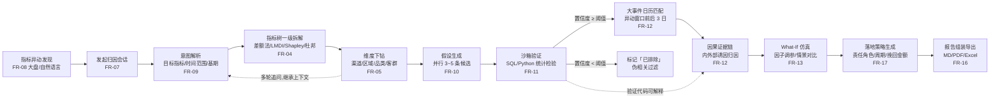
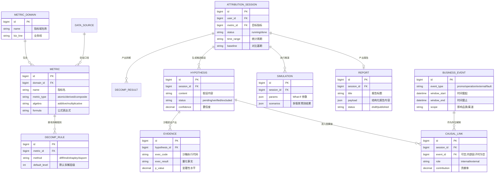

# cause_trace 经营归因分析系统 需求规格说明书（PRD）

> | 文档名称 | cause_trace 经营归因分析系统 需求规格说明书（PRD） |
> |----------|----------------------|
> | 版本 | v1.2（确认基线） |
> | 作者角色 | 产品经理 |
> | 日期 | 2026-10-14 |
> | 状态 | 基线确认稿 |

> **编制说明**：本文档基于《需求参考.md》2.1 节「经营归因分析系统」与现有四工程代码资产（`auth` / `data-agent` / `dbmock` / `insight-agent`，代码根目录 `资料/代码/insight/`）的实地分析编制。功能需求清单中「现状」一列标注了截至 2026-10-14 的代码满足程度（已实现 / 部分实现 / 未实现），详细的需求-代码映射见 **附录 A**。

---

## 变更记录

| 版本 | 日期 | 作者 | 变更说明 |
|------|------|------|----------|
| v1.0 | 2026-10-14 | 产品经理 | 初稿，覆盖 1~12 章 + 附录 A/B/C |
| v1.1 | 2026-10-14 | 产品经理 | 补 FR-21~FR-24、前后端模块映射、核心流程文字版、报告七章节规范 |
| v1.2 | 2026-10-14 | 产品经理 | 版本号升级为确认基线；新增术语表；FR-22 优先级 P1→P0；AC 表末行改 AC-OVERALL；新增 Q11/Q12 待确认项 |

---

## 0. 术语表

| 术语 | 说明 |
|------|------|
| **指标树** | 复合指标按数学关系逐级拆解形成的层级结构，如 GMV = 访客数 × 转化率 × 客单价 |
| **原子指标** | 不可再拆的最细粒度指标，如访客数、订单数 |
| **派生指标** | 由原子指标按公式计算得出的指标，如转化率、客单价 |
| **复合指标** | 由多个指标通过加法或乘法模型组合得到的指标，如 GMV、利润 |
| **加法模型** | 形如 `Y = X1 + X2 - X3` 的指标，贡献率分解采用差额分析法 |
| **乘法模型** | 形如 `Y = X1 × X2 × X3` 的指标，贡献率分解采用 LMDI |
| **差额分析法** | 加法模型下各因子差额绝对值与贡献率的一种分解方法 |
| **LMDI** | Logarithmic Mean Divisia Index，对数平均迪氏指数法，乘法模型贡献率分解，保证无交叉残差 |
| **Shapley 值分解** | 基于合作博弈论的贡献分摊方法，用于维度下钻的多因子贡献率计算 |
| **杜邦分析** | 将核心指标按财务比率逐级拆解的方法，如 ROE = 净利率 × 总资产周转率 × 权益乘数 |
| **伪相关** | 统计上相关但非因果的关系，需通过控制变量与显著性检验排除 |
| **What-If 仿真** | 基于敏感性/弹性系数的反事实推演，用于策略效果预估 |
| **因果证据链** | 由数据验证证据、代码执行结果与统计显著性构成的归因推理链条 |
| **ground truth** | 异动仿真注入时记录的真实原因标记，用于验收与演示复盘 |
| **异动窗口** | 指标发生异常波动的时间范围，事件关联时取前后 3 日 |

---

## 1. 产品目标与价值

### 1.1 背景与要解决的问题

企业经营指标（GMV、利润率、续约率等）发生异常波动时，分析师依赖人工取数、经验推测定位原因，归因周期长、贡献率不可量化，且容易把外部干扰（大促、竞品动作、宏观事件）误判为内部操作问题，导致纠偏动作失焦。

### 1.2 建设目标

建设面向企业核心经营场景的智能多维归因分析系统 **cause_trace**，实现「指标树因子拆解 → 自动假设生成 → 沙箱统计验证 → 大事件因果关联 → What-If 反事实仿真 → 结构化报告导出」的全链路闭环，输出具备量化贡献率与落地策略的深度经营洞察。交付形态为：三栏交互式归因工作台（前端）+ 含统计检验与代码沙箱执行器的后端服务 + 示例多维数仓数据集与异动仿真案例 + 多格式报告导出模块。

### 1.3 成功标准（可量化）

- **守恒性**：复合指标多级因子拆解后，各因子贡献量之和与总指标变动量的偏差为 **0**（加法差额 / LMDI / Shapley 均满足，无交叉残差）。
- **假设闭环**：单次归因会话自动并行生成 **3~5 条**候选假设，每条假设均产出可执行的沙箱验证代码与置信度，置信度低于阈值的假设 **100%** 自动标记为「已排除」。
- **事件关联**：指标异动时间窗口前后 **3 日**内的业务日历事件自动匹配，时间/品类/渠道重合的事件 100% 进入因果链。
- **策略可执行**：系统输出的每条建议 100% 绑定量化驱动因子、责任角色、预期恢复周期与预期挽回金额。
- **交付完整性**：至少 **2 个**预置业务场景（电商 GMV 下滑归因 + 快消品利润率异动归因）完成全链路闭环演示；报告支持 **Markdown / PDF / Excel** 三种格式导出。

### 1.4 开发范围与交付形式（对齐需求参考 2.1.1）

#### 1.4.1 开发范围

- **基础能力**：统一认证登录、多指标域与业务线管理、多轮探索会话管理、数据源接入、操作审计与运行日志。
- **指标建模与因子拆解能力**：多层级指标树构建、加法/乘法模型贡献率分解（差额分析法、LMDI、Shapley、杜邦分析）、多维交叉下钻（时间、渠道、区域、品类、客群）。
- **智能假设与验证引擎**：基于 LLM 与统计算法自动生成归因假设、调用安全数据沙箱执行 SQL/Python 统计验证、相关性检验、变动贡献率定量核算、伪相关排除。
- **业务大事件因果关联**：企业营销日历、运营动作、外部竞品与宏观事件录入与关联匹配，避免机械数值推导，实现业务语境融合归因。
- **决策仿真与建议生成**：基于敏感性分析提供 What-If 策略推演，输出包含责任岗位、行动建议和预期收益的落地策略。
- **工作台交互与呈现**：多轮探索对话区、指标异动瀑布流图、下钻数据透视表、因果证据链展示、报告在线协同与一键多格式导出。

#### 1.4.2 交付形式

- 可运行前端：三栏交互式归因工作台。
- 后端服务：含统计检验与代码沙箱执行器。
- 示例多维数仓数据集。
- 典型大促与经营异动仿真案例。
- 多格式报告导出模块：Markdown、PDF、Excel。
- 完整分析演示链路。

---

## 2. 用户角色与权限矩阵

| 角色 | 职责描述 | 核心权限 |
|------|---------|---------|
| 经营分析师 | 归因分析的发起者与执行者 | 创建/切换归因会话；设定目标指标、时间范围与对比基期；调优指标拆解逻辑；审核归因证据链；调整 What-If 模拟参数；发布与导出经营分析报告；查看本人及被授权范围内的会话 |
| 业务负责人 / 管理层 | 归因结论的消费者 | 查看指标异动大盘；查看结构化归因结论与量化贡献率；查看行动项建议；订阅周期性归因简报（只读，不可编辑分析） |
| 系统与数据管理员 | 平台配置与治理者 | 维护指标元数据与拆解公式（指标字典）；配置数据源连接；维护业务大事件日历；管理模型调用参数与沙箱安全配额；管理用户/角色/权限；查看全量操作审计 |

**权限落地说明**：现有 `auth` 服务已实现完整 RBAC（用户-角色-权限三层关系 + 通配符超管 + 权限变更实时刷新令牌 scope），上述三个角色需落为具体权限点（如 `read:insight-agent` 已在 platform 门户预置），业务接口按 introspection 返回的 scope 做细粒度鉴权。

---

## 3. 用户故事

- US-01：作为经营分析师，我希望在大盘上看到异常波动指标（如日环比跌幅超阈值被突出标识），并一键发起「智能归因分析」，以便快速启动异动定位。（→ FR-01、FR-08）
- US-02：作为经营分析师，我希望用自然语言描述归因需求（如"为什么上周转化率下降"），系统自动解析目标指标、时间范围与对比基期（同比/环比/目标差），以便无需手工拼装查询条件。（→ FR-09）
- US-03：作为经营分析师，我希望查看指标树第一级因子的数学拆解结果与贡献率瀑布图，且各因子贡献之和严格等于总变动，以便信任拆解结果无残差。（→ FR-04、FR-14）
- US-04：作为经营分析师，我希望对核心因子按渠道/区域/品类/客群多维交叉下钻，在透视表中查看各细分维度对大盘波动的拉动率，以便定位异动集中的维度组合。（→ FR-05、FR-15）
- US-05：作为经营分析师，我希望审阅系统并行生成的候选假设、各自的沙箱验证证据与置信度，低置信度假设被自动排除，以便排除伪相关干扰、锁定核心因子。（→ FR-10、FR-11）
- US-06：作为经营分析师，我希望对阶段性结论发起多轮追问，系统继承前序上下文、锁定异常切片继续深挖，以便逐层定位深层原因。（→ FR-07、FR-09）
- US-07：作为经营分析师，我希望系统自动匹配异动窗口前后的业务大事件（大促、故障、竞品动作）并纳入因果链，以便区分外生扰动与内部操作问题。（→ FR-12）
- US-08：作为经营分析师，我希望在 What-If 模拟器中调节驱动因子参数（如渠道预算重配、价格调整），实时推演目标指标预期变动与收益区间，以便量化策略效果。（→ FR-13）
- US-09：作为经营分析师，我希望将整个分析会话组装为包含七章节的结构化经营归因报告，并一键导出 PDF / Excel / Markdown，以便向管理层汇报与归档。（→ FR-16）
- US-10：作为业务负责人，我希望查看指标异动大盘、结构化归因结论、量化贡献率与行动项建议，并订阅周期性归因简报，以便低成本掌握经营异动与整改进展。（→ FR-02、FR-08、FR-19）
- US-11：作为系统与数据管理员，我希望维护指标字典（原子/派生/复合指标公式与默认拆解层级树），以便指标口径统一、拆解逻辑可复用。（→ FR-03）
- US-12：作为系统与数据管理员，我希望维护业务大事件日历并配置数据源连接与沙箱安全配额，以便平台数据与安全边界可控。（→ FR-06、FR-11、FR-12、FR-21）

---

## 4. 功能需求清单（需求池）

> 「现状」列基于 2026-10-14 代码分析：**已实现** = 代码可用；**部分实现** = 有底座但缺关键能力；**未实现** = 需从零建设。

| 编号 | 模块 | 功能 | 优先级 | 说明 | 现状 |
|------|------|------|--------|------|------|
| FR-01 | 基础能力 | 统一认证登录 | P0 | OAuth2 授权码 + PKCE 登录、令牌内省、登出、会话管理 | 已实现（auth 服务：30+ 端点、opaque token + introspection、权限实时刷新） |
| FR-02 | 基础能力 | 多指标域与业务线管理 | P0 | 指标域/业务线的创建、隔离、权限归属；分析师的会话与数据可见范围按业务线隔离 | 未实现（platform 门户已有"归因分析"功能入口雏形） |
| FR-03 | 指标建模 | 指标字典配置 | P0 | 维护原子/派生/复合指标、公式、默认拆解层级树 | 部分实现（data-agent 有 21 个指标的元数据表与 Qdrant 向量，无指标树、无配置 UI） |
| FR-04 | 指标建模 | 指标树构建与贡献率分解 | P0 | 加法模型差额分析；乘法模型 LMDI 分解；维度下钻 Shapley/占比贡献；杜邦分析；总和守恒 | 未实现 |
| FR-05 | 指标建模 | 多维交叉下钻 | P0 | 按时间/渠道/区域/品类/客群下钻，输出拉动率与 TOP 维度组合 | 部分实现（data-agent Text2SQL 可取数，无下钻交互结构与拉动率计算） |
| FR-06 | 基础能力 | 数据源接入 | P0 | 数仓连接配置、只读账号与库表权限管理 | 部分实现（data-agent 已连 MySQL warehouse，但为 root 全权限账号，无只读约束） |
| FR-07 | 基础能力 | 归因会话管理 | P0 | 多轮会话创建/切换/历史恢复、上下文维护、断点保持 | 已实现（insight-agent：conversation/message/context_compaction 三表 + WebSocket 流式 + 上下文压缩） |
| FR-08 | 工作台 | 指标异动大盘 | P0 | 核心经营指标监控看板，异常波动突出标识（日环比跌幅超阈值），一键发起归因 | 未实现 |
| FR-09 | 分析引擎 | 意图理解与多轮追问 | P0 | 解析目标指标/时间范围/对比基期；规划分析步骤；多轮追问继承上下文 | 部分实现（deepagents 对话与工具调用已具备，无结构化意图解析与规划调度） |
| FR-10 | 分析引擎 | 归因假设自动生成 | P0 | 根据因子异动特征并行生成 3~5 条候选假设并呈现假设看板 | 未实现 |
| FR-11 | 分析引擎 | 假设沙箱验证 | P0 | 为每条假设生成可执行探查代码；安全沙箱执行 SQL/Python；统计检验（相关性/显著性）；量化贡献率；置信度低于阈值自动排除伪相关 | 部分实现（data-agent 具备 SQL 生成-校验-纠错-执行链路，但无沙箱隔离、无超时/配额、无 Python 执行、无假设状态机） |
| FR-12 | 分析引擎 | 业务大事件因果关联 | P0 | 营销日历/运营动作/外部事件录入；异动窗口前后 3 日自动匹配；事件作为外生解释变量进入因果链 | 未实现（dbmock 的促销活动/优惠券维度表可作数据基础） |
| FR-13 | 决策仿真 | What-If 仿真推演 | P0 | 基于敏感性/弹性系数构建推演模型；因子参数交互式调节；实时重算与情景对比 | 未实现 |
| FR-14 | 工作台 | 数据可视化引擎 | P0 | 因子贡献瀑布图、杜邦拆解树、下钻时序趋势图、桑基图、假设卡片流 | 部分实现（insight-agent 的 render_report.py 支持 ECharts 图表块的 HTML 报告渲染；前端无图表库、无交互式可视化） |
| FR-15 | 工作台 | 动态透视表 | P0 | 多维层级折叠、列头排序、差额高亮染色、一键导出当前表格；支撑下钻证据呈现 | 未实现 |
| FR-16 | 工作台 | 报告组装与导出 | P0 | 按七章节规范组装结构化报告；在线预览、批注、归档；导出 PDF/Excel/Markdown | 部分实现（HTML 自包含报告生成 + iframe 预览 + 附件下载链路已通；无结构化落库、无 MD/PDF/Excel 导出） |
| FR-17 | 决策仿真 | 落地策略生成 | P0 | 每条建议绑定量化驱动因子、责任角色、预期恢复周期、预期挽回金额 | 未实现 |
| FR-18 | 基础能力 | 操作审计与运行日志 | P0 | 分析操作、模型调用、沙箱执行的审计留痕；审计查询、导出、保留期管理 | 部分实现（trace 中间件注入 request_id + loguru 文件日志，无审计表与审计查询） |
| FR-19 | 工作台 | 周期简报订阅 | P2 | 管理层订阅周期性归因简报（定时生成与推送） | 未实现 |
| FR-20 | 数据资产 | 示例数据集与仿真案例 | P0 | 电商 GMV、快消品利润率、SaaS 续约率三类场景数据；指标异动仿真注入（时间窗 × 维度 × 指标 × 幅度）；至少 2 个场景全链路演示 | 部分实现（dbmock 已生成 24 张 DWD 表、100 万订单、240 万行为事件的电商数仓，内置大促加权仿真；**异动注入机制完全缺失**，快消/SaaS 场景未建） |
| FR-21 | 基础能力 | 模型调用参数与沙箱安全配额管理 | P0 | 管理员配置 LLM 参数、沙箱 CPU/内存/超时/并发/结果集配额；超限拒绝并记录审计 | 未实现 |
| FR-22 | 工作台 | 报告在线协同 | P0 | 报告批注、评论、@提及、版本对比、分享链接、协同状态与只读/可编辑权限 | 未实现 |
| FR-23 | 数据资产 | 异动仿真注入配置 | P0 | 按“时间窗 × 维度 × 指标 × 幅度”注入异动，生成 ground truth 标记，用于演示与验收 | 未实现 |
| FR-24 | 工作台 | 异常检测阈值配置 | P1 | 按指标配置日环比/同比/目标差阈值、告警级别与通知通道 | 未实现 |

- 优先级：P0 必须 / P1 重要 / P2 可选。P0 覆盖「发起 → 拆解 → 下钻 → 假设 → 验证 → 因果 → 仿真 → 报告」主流程全环节。
- **代码复用导向**：FR-01/07/11/14/16/20 建议在现有 auth / insight-agent / data-agent / dbmock 资产上增量建设，而非推倒重来。

### 4.1 前端模块与需求映射（对齐需求参考 2.1.5）

| 需求参考模块 | 对应 FR | 说明 |
|--------------|---------|------|
| 工作台框架与会话模块 | FR-07 | 左中右三栏弹性布局、折叠展开、历史会话切换、实时任务断点保持 |
| 实时交互与思维链流式模块 | FR-09 | 自然语言解析结果、执行规划步骤、假设卡片流、工具调用状态流式渲染 |
| 数据可视化引擎模块 | FR-14 | 因子贡献瀑布图、指标杜邦拆解树、下钻时序趋势图、桑基图 |
| 动态透视表模块 | FR-15 | 多维层级折叠、列头排序、差额高亮、一键导出当前表格 |
| What-If 仿真器模块 | FR-13 | 客户端驱动因子交互式滑块调参、敏感度曲线实时重算、情景对比 |
| 报告组装与导出模块 | FR-16 / FR-22 | 图表、结论、数据表一键组装为标准化经营简报；批注协同、打印、多格式导出 |

### 4.2 后端与分析引擎模块映射（对齐需求参考 2.1.6）

| 需求参考模块 | 对应 FR | 说明 |
|--------------|---------|------|
| 指标体系与公式引擎模块 | FR-03 / FR-04 | 指标元数据、层级树、加法/乘法模型动态代数分解 |
| 意图理解与规划调度模块 | FR-09 | 解析归因意图，动态规划：识别异动→指标拆解→维度下钻→假设生成→统计检验→业务归因→策略建议 |
| 安全数据分析沙箱模块 | FR-11 / FR-21 | 受限只读查询与脚本分析，执行 LMDI、假设检验；超时/配额/白名单 |
| 因果关联与知识引擎模块 | FR-12 | 检索业务事件日历与历史归因库，计算相关度，生成因果解释链 |
| 敏感性模拟与建议引擎模块 | FR-13 / FR-17 | 基于弹性系数与历史波动率构建 What-If 模型，输出多情景预测与优先建议 |
| 会话状态与报告管理模块 | FR-07 / FR-16 / FR-22 | 多轮上下文、中间快照、报告结构化落库、协同与导出 |

---

## 5. 非功能需求（量化）

> 标注「建议值」的指标为行业常规水位、需干系人评审确认（见 Q1）；其余为现有代码已具备或参考文档明确规定的约束。

| 类别 | 要求 | 指标 |
|------|------|------|
| 性能 | 分析过程流式反馈 | 每个分析步骤（拆解/下钻/假设/验证）状态变更流式推送，单步可见延迟 ≤ 2s（建议值） |
| 性能 | 沙箱 SQL 执行 | 单条语句超时 ≤ 30s；结果集上限 10 万行；单用户并发查询 ≤ 3（新增约束） |
| 性能 | 指标异动大盘 | 首屏加载 ≤ 3s（P95，建议值） |
| 性能 | 数仓规模适配 | 支持千万级事实表（dbmock 现状：100 万订单 + 240 万行为事件）聚合查询 |
| 安全 | 沙箱隔离 | 专用只读数据库账号 + SQL 静态解析白名单（仅 SELECT）+ 写操作关键字拦截 + 资源限额；Python 执行环境与宿主机隔离 |
| 安全 | 认证与令牌 | OAuth2 授权码 + PKCE(S256)；令牌服务端内省；WebSocket 一次性令牌（30s，已实现） |
| 安全 | 数据脱敏 | 示例数据集手机/邮箱/姓名/地址脱敏（沿用 dbmock 规范：138\*\*\*\*8888 等） |
| 安全 | 敏感配置 | LLM API Key 等敏感配置不得明文入库/入配置库（现状：data-agent/insight-agent 配置文件中存在明文 Key，需整改） |
| 可用性 | 服务可用性 | 核心服务 SLA ≥ 99.5%（建议值）；沙箱执行失败不阻塞分析会话其他能力 |
| 兼容性 | 浏览器 | Chrome / Edge 最新两个大版本；桌面端优先（三栏工作台） |
| 并发 | 并发分析会话 | ≥ 20 个并发归因会话（建议值） |
| 可观测性 | 全链路追踪 | request_id 贯穿前后端（已实现）；分析步骤级审计记录（假设-验证-结论可回溯） |

---

## 6. 核心业务流程

### 6.1 指标异动发现与归因发起流程

1. 用户在监控大盘发现关键指标异常，或在工作台输入自然语言归因需求。
2. 系统解析目标指标、时间范围与对比基期（同比、环比、目标差）。
3. 系统读取指标树定义，完成第一级核心因子数学拆解与大盘拉动率计算。

### 6.2 假设生成与多维下钻验证流程

1. 引擎根据因子异动幅度生成 3~5 个候选归因假设，并在界面呈现假设看板。
2. 引擎为各假设编写沙箱验证代码，并行执行维度交叉探查（按渠道、人群、品类拆解）。
3. 过滤无关假设，筛选出贡献率超过显著性阈值的核心因子与异动维度。
4. 检索大事件日历，匹配营销大促、系统故障等外部解释变量，补全因果链条。

### 6.3 多轮交互追问与深度探查流程

1. 用户针对阶段性结论发起追问。
2. 系统继承前序分析上下文，锁定异常切片，进一步向下钻取细分指标与底层行为数据。
3. 系统动态更新归因看板与证据透视表，生成深层原因结论。

### 6.4 What-If 模拟推演与报告产出流程

1. 系统基于归因结果锁定可干预驱动因子，生成优化策略候选方案。
2. 用户在模拟器调节参数，系统实时推演目标指标预期变动幅度与收益区间。
3. 系统组装指标异动、量化归因、证据图表、模拟结果与策略建议，生成完整结构化经营归因报告并支持导出。

### 6.5 核心业务流程图



流程说明：四个子流程与参考文档 2.1.7 一致——① 异动发现与归因发起（A→D）；② 假设生成与多维下钻验证（E→H）；③ 多轮交互追问与深度探查（E↔C 回环）；④ What-If 推演与报告产出（I→L）。

---

## 7. 关键页面原型说明

### 7.1 指标异动大盘页（FR-08）

```
+------------------------------------------------------------------+
| 指标异动大盘            [指标域筛选 v] [业务线筛选 v] [时间范围 v]  |
+------------------+------------------+------------------+----------+
| GMV   ¥1,024万   | 转化率  2.31%    | 客单价  ¥186     | 利润率   |
| 日环比 -12.3% !! | 日环比 -0.4pct ! | 日环比 -3.1%     | 5.2%     |
+------------------+------------------+------------------+----------+
| 异动指标列表（按跌幅排序）                                        |
| [GMV] 日环比 -12.3%  异动开始 08-12 14:00   [发起智能归因] 按钮   |
| [搜索流量] 日环比 -18.7% ...                                     |
| [支付成功率] 日环比 -2.1pct ...                                  |
+------------------------------------------------------------------+
| 异常指标趋势缩略图（近30天时序，异动点红色标记）                  |
+------------------------------------------------------------------+
```

### 7.2 归因分析工作台（FR-07/09/14/15，三栏）

```
+----------+-----------------------------+---------------------------+
| 会话与   | 对话与探索交互区            | 动态归因看板区            |
| 指标导航 |                             |                           |
|          | [用户] 为什么上周GMV下滑?   | [归因结论卡片]            |
| +新建    | [助手] 正在解析意图...      |  主因:渠道结构恶化 68%    |
|  分析    |   步骤1 指标拆解 完成       |  次因:转化率下降 22%      |
|          |   步骤2 维度下钻 运行中     |  外因:竞品大促(事件#12)   |
| 会话列表 | [假设看板]                  |                           |
| > GMV    |  H1 高流量低转化渠道占比提升| [因子贡献瀑布图]          |
|   下滑   |    置信度 87% 已验证        |  流量 -45% ▓▓▓           |
| > 利润率 |  H2 某品类断货致客单价下滑  |  转化 -32% ▓▓             |
|   异动   |    置信度 91% 已验证        |  客单价 -18% ▓            |
|          |  H3 大促退款率上升          |  交叉项   -5% ▓           |
| 当前指标 |    置信度 34% 已排除        |                           |
| GMV      |                             | [下钻透视表] 可展开维度   |
| 拆解树   | [追问输入框________] [发送] | [What-If 面板] 滑块调参   |
| (杜邦)   | 流式中... [停止生成]        | [导出报告] MD/PDF/Excel   |
+----------+-----------------------------+---------------------------+
```

### 7.3 业务事件日历页（FR-12）

```
+------------------------------------------------------------------+
| 业务事件日历                        [新建事件]                    |
|  < 2026年8月 >                                                  |
| 08-10 [平台大促] 818家电节 全品类        关联指标: GMV/流量      |
| 08-12 [竞品动作] 竞品A百亿补贴 手机数码  关联指标: GMV/转化      |
| 08-15 [系统故障] 支付通道抖动 40min      关联指标: 支付成功率     |
| 08-18 [运营动作] 首页改版v3.2            关联指标: 流量/转化      |
|  事件字段: 名称/类型(营销/运营/外部/故障)/时间窗/影响品类或渠道/  |
|            备注/录入人                                            |
+------------------------------------------------------------------+
```

### 7.4 指标字典配置页（FR-03）

```
+----------------------------------+-------------------------------+
| 指标树（可拖拽调整层级）          | 指标编辑面板                  |
| ▼ GMV（复合·乘法）               | 名称: GMV                    |
|   ▼ 访客数（原子）               | 类型: 复合指标               |
|   ▼ 转化率（派生）               | 模型: 乘法                   |
|   ▼ 客单价（派生）               | 公式: 访客数×转化率×客单价    |
| ▼ 利润（复合·加法）              | 分解方法: LMDI                |
|   ▶ 营收    ▶ 成本              | 数据源: dwd_fact_trade_*     |
| + 新增指标 / + 新增维度          | 默认拆解层级: 2              |
+----------------------------------+-------------------------------+
```

### 7.5 报告归档与导出预览页（FR-16/22）

```
+------------------------------------------------------------------+
| 报告标题: 8月GMV下滑归因报告   状态:已发布  [导出 v] [打印]      |
+----------------------------------+-------------------------------+
| 1 异动背景与问题定义（指标/周期/基期值/现期值/差异额/差异率）     |
| 2 因子贡献率拆解（瀑布图 + 贡献率表格）                          |
| 3 细分维度下钻证据（TOP 维度组合 + 透视表）                      |
| 4 核心归因结论（首要/次要原因、内外部诱因）                      |
| 5 因果证据链与检验置信度（代码执行结果 + 显著性水平）            |
| 6 What-If 情景模拟结论（改善空间区间）                           |
| 7 可落地策略行动清单（动作/责任岗位/周期/预期收益）              |
+------------------------------------------------------------------+
| 批注区: [选中文本添加批注]  历史版本: v1 v2 v3                   |
+------------------------------------------------------------------+
```

---

## 8. 数据实体初稿（ER）



**与现有表的关系**：`insight-agent` 已有的 `conversation` / `message` / `context_compaction` 三表继续承载多轮对话与流式消息；`ATTRIBUTION_SESSION` 与 `conversation` 一对一关联（会话即对话）。`data-agent` 已有的 `table_info` / `column_info` / `metric_info` / `column_metric` 元数据表作为 `DATA_SOURCE` 与 `METRIC` 的基础数据来源。

---

## 9. 报告与输出格式规范（对齐需求参考 2.1.8）

报告必须包含以下七章节：

1. **异动背景与问题定义**：目标指标、统计周期、基期值、现期值、总差异额、差异率。
2. **因子贡献率拆解**：瀑布流图与表格，列出各驱动因子的绝对贡献值、贡献率百分比、拉动方向。
3. **细分维度下钻证据**：异动最集中的 TOP 维度组合、明细数据透视表、关键变化特征。
4. **核心归因结论**：首要原因、次要原因、内外部诱因，结构化阐明。
5. **因果证据链与检验置信度**：数据验证证据、代码执行结果、统计显著性水平。
6. **What-If 情景模拟结论**：不同调优策略下的目标指标预估改善空间。
7. **可落地策略行动清单**：业务整改动作、责任岗位、预估完成周期、预期业务收益。

---

## 10. 验收标准（AC）

| 功能（FR） | 验收条件（前置—操作—预期） |
|-----------|--------------------------|
| FR-01 | 给定未登录用户，当访问工作台，则被重定向至认证中心；完成 OAuth 登录后携令牌进入工作台，无权限功能不可见 |
| FR-04 | 给定复合指标 GMV（乘法模型），当执行一级拆解，则输出各因子绝对贡献值与贡献率，且各因子贡献量之和与总变动量偏差为 0 |
| FR-04 | 给定复合指标利润（加法模型），当执行差额分析，则各组成因子差额之和等于利润总变动 |
| FR-05 | 给定已拆解的转化率因子，当按渠道维度下钻，则输出各渠道拉动率透视表，TOP 维度组合按贡献降序且差额高亮 |
| FR-07/09 | 给定进行中的归因会话，当用户发起追问"这个渠道为什么差"，则系统继承前序上下文、锁定异常切片继续下钻，历史消息不丢失 |
| FR-10/11 | 给定一次指标异动，当系统完成假设生成，则并行产出 3~5 条候选假设；每条假设附带沙箱执行代码、量化事实与置信度；置信度低于阈值的假设标记为「已排除」且不进入最终结论 |
| FR-11 | 给定假设验证代码含写操作（UPDATE/DELETE/DDL），当提交沙箱执行，则被安全策略拦截并记录审计日志 |
| FR-12 | 给定异动发生于 08-12，当执行业务归因，则自动匹配 08-09~08-15 窗口内日历事件；时间与品类重合的事件作为外生解释变量出现在因果链中 |
| FR-13 | 给定归因结论锁定"渠道预算"为可干预因子，当用户在模拟器将某渠道预算 +20%，则实时重算目标指标预期变动并展示与基准情景的对比区间 |
| FR-16 | 给定一份完成的归因分析，当点击导出，则分别成功产出 Markdown、PDF、Excel 三种格式文件，内容均包含七章节（异动背景/因子拆解/下钻证据/核心结论/证据链与置信度/What-If 结论/策略清单） |
| FR-17 | 给定任一策略建议，当查看建议详情，则必须包含量化驱动因子、责任角色、预期恢复周期与预期挽回金额，缺一即视为不通过 |
| FR-20 | 给定预置「电商 GMV 下滑」场景数据（含 08-12 注入的转化率下跌异动），当运行全链路归因演示，则系统正确定位注入的异动来源并输出完整报告 |
| FR-21 | 给定管理员配置的沙箱配额（CPU/内存/超时/并发/结果集），当分析任务超限，则拒绝执行并记录审计日志，且不阻塞其他会话 |
| FR-22 | 给定一份已发布的归因报告，当用户添加批注并 @ 指定同事，则被 @ 用户收到通知；历史版本可对比，且只读角色无法编辑正文 |
| FR-23 | 给定异动仿真注入配置（时间窗 × 维度 × 指标 × 幅度），当运行演示，则系统能识别注入的异动并生成 ground truth 对照 |
| AC-OVERALL | 在大盘或工作台成功发起指定指标归因会话；生成总和守恒的贡献率瀑布图；完成伪相关排除；三栏工作台多轮下钻；输出结合业务语境的因果解释；What-If 实时推演；结构化报告三格式导出；至少两组预置场景闭环演示 |

---

## 11. 依赖与约束

**外部依赖**：

| 依赖项 | 用途 | 可控性 |
|--------|------|--------|
| LLM 服务（OpenRouter 网关：DeepSeek / Qwen） | 意图解析、假设生成、代码生成、报告撰写 | 外部服务，需保障可用性与 Key 管理（现状：Key 明文存放需整改） |
| auth 认证服务（端口 7100） | 统一登录、令牌内省、RBAC | 内部可控（已交付） |
| data-agent 服务（端口 8000） | Text2SQL 取数、元数据召回 | 内部可控（已交付，需补沙箱安全） |
| MySQL 8.0 | chat 库 / meta 库 / warehouse 数仓 | 内部可控 |
| Redis | WebSocket 一次性令牌 | 内部可控 |
| Elasticsearch + Qdrant + TEI(BGE) | 字段取值检索 / 向量召回 / 向量化 | 内部可控（data-agent 已容器化） |
| Tavily MCP | 外部信息检索（可选增强） | 外部服务 |
| LibreOffice / 报表渲染组件（PDF/Excel 导出） | 报告多格式导出 | 待选型确认（见 Q4） |

**约束**：

- 技术栈约束：后端 Python 3.12 + uv + FastAPI + SQLAlchemy；前端 React 19 + Vite 7 + TypeScript + Tailwind + zustand；既有四工程（auth/data-agent/dbmock/insight-agent）资产必须复用，不推倒重来。
- 数据库约束：auth 服务当前仅支持 SQLite（生产化需评估 MySQL 适配）；data-agent 与 dbmock 直连 MySQL `warehouse` 库（root 账号现状需整改为只读专用账号）。
- 安全约束：沙箱执行器需在隔离环境中运行，禁止触碰宿主机与生产数仓写权限。
- 组织约束：示例数据集中的品牌/店铺/人名均为模拟数据，禁止接入真实用户隐私数据。

---

## 12. 待确认问题（Open Questions）

| 编号 | 问题 | 建议确认方 |
|------|------|-----------|
| Q1 | 非功能量化指标（首屏 ≤3s、SLA 99.5%、并发 20 等）为建议值，需按实际业务量级拍板 | 业务负责人 + 技术负责人 |
| Q2 | 多指标域与业务线的组织口径（按事业部/品牌/区域划分？）与分析师的数据可见范围是否按业务线隔离 | 业务负责人 |
| Q3 | Python 沙箱执行器的隔离级别选型（容器 / 微 VM / nsjail）及安全责任边界；沙箱可用资源配额上限 | 技术负责人 + 安全 |
| Q4 | 报告导出 PDF/Excel 采用服务端渲染（引入 LibreOffice 等依赖）还是前端导出（SheetJS/打印），以及批注功能的存储方式 | 产品 + 技术负责人 |
| Q5 | 指标异动检测的阈值规则（日环比跌幅阈值按指标分别配置？）与异常告警的通知通道（邮件/企业微信/站内） | 业务负责人 |
| Q6 | 周期简报的订阅范围（全量指标域 or 指定指标）、生成频率与推送形式 | 业务负责人 |
| Q7 | 报告在线协同的范围：仅批注评论，还是需要多人实时协同编辑？版本保留策略？ | 产品 + 业务负责人 |
| Q8 | 周期简报推送通道：邮件 / 企业微信 / 站内信 / 钉钉，是否需要模板定制？ | 业务负责人 |
| Q9 | 异动仿真注入的 ground truth 是否需要在前端隐藏，仅用于验收与演示复盘？ | 产品 + 技术负责人 |
| Q10 | 沙箱 Python 执行是否允许安装第三方包？若允许，包白名单与镜像源如何管理？ | 技术负责人 + 安全 |
| Q11 | 报告批注的存储方式：独立表 or 内嵌 payload？是否需要全文检索？ | 产品 + 技术负责人 |
| Q12 | 异常告警通道是归 FR-12 事件日历，还是归 FR-24 阈值配置？两个模块边界如何界定？ | 产品 + 业务负责人 |

---

## 附录 A：需求满足度与差距分析矩阵（代码 vs 需求参考）

> 分析基线：`资料/代码/insight/` 下四工程，分析日期 2026-10-14。

| 需求参考条目 | 对应代码资产 | 满足度 | 差距与后续动作 |
|--------------|--------------|--------|----------------|
| 2.1.1 基础能力 - 统一认证登录 | `auth`（OAuth2+PKCE、RBAC、令牌内省、权限实时刷新） | ★★★★☆ 已实现 | 补齐：登录限流/防爆破、审计日志表、生产数据库适配（现仅 SQLite） |
| 2.1.1 基础能力 - 多指标域/业务线、数据源接入、审计日志 | 无专门实现；`data-agent` 有 meta 库表元数据 | ★☆☆☆☆ 未实现 | 新建指标域管理、数据源配置（只读账号）、审计落库 |
| 2.1.1 指标树与贡献率分解（LMDI/Shapley/杜邦） | `data-agent` 指标元数据表（21 指标） | ★☆☆☆☆ 未实现 | 新建指标树模型 + 三种分解算法引擎（总和守恒为硬验收） |
| 2.1.1 多维交叉下钻 | `data-agent` Text2SQL 12 节点图（召回→过滤→生成→校验→纠错→执行） | ★★☆☆☆ 底座可用 | 在下钻前端结构与拉动率计算层新建；SQL 执行侧补只读/超时/行数限制 |
| 2.1.1 假设生成与沙箱验证（SQL/Python） | `data-agent` SQL 生成执行链路；`insight-agent` deepagents 工具/子 Agent | ★★☆☆☆ 部分 | **安全沙箱整体缺失**（root 直连、无白名单/超时/配额）；Python 执行环境从零建设；假设实体与状态机新建 |
| 2.1.1 大事件因果关联 | `dbmock` 促销活动/优惠券维度表 | ★☆☆☆☆ 未实现 | 新建事件日历维护 + 前后 3 日窗口匹配 + 因果链模型 |
| 2.1.1 What-If 与策略生成 | 无 | ☆☆☆☆☆ 未实现 | 新建敏感性模拟引擎与建议生成规则 |
| 2.1.2 三角色与权限 | `auth` RBAC（user-role-permission + 通配符 + scope 实时刷新） | ★★★★☆ 机制已具备 | 将经营分析师/管理层/管理员落为具体权限点与前端菜单控制 |
| 2.1.3 指标异动大盘页 | `auth/platform` 门户有"归因分析"入口（7300） | ★☆☆☆☆ 未实现 | 新建大盘页（监控、异常标识、一键归因） |
| 2.1.3 归因分析工作台（三栏） | `insight-agent/web` 准三栏聊天页（会话列表 + 消息流 + 条件性 HTML iframe 预览） | ★★☆☆☆ 部分 | 第三栏升级为持久化动态看板（瀑布图/透视表/What-If）；前端补图表库与透视表组件（现无任何图表依赖） |
| 2.1.3 业务事件日历页 | 无 | ☆☆☆☆☆ 未实现 | 新建 |
| 2.1.3 指标字典配置页 | `data-agent` `meta_config.yaml`（2965 行手工维护） | ★☆☆☆☆ 未实现 | 新建可视化配置页，元数据从 YAML 迁入可管理存储 |
| 2.1.3 报告归档与导出预览页 | `insight-agent` `.deepagents/skills/insight/scripts/render_report.py`（ECharts HTML 报告） | ★★★☆☆ 部分 | 报告结构化落库 + MD/PDF/Excel 导出 + 批注与版本 |
| 2.1.4 拆解规则（差额/LMDI/Shapley） | 无算法实现 | ☆☆☆☆☆ 未实现 | 新建（P0，总和守恒硬指标） |
| 2.1.4 假设生成与双向验证规则 | `data-agent` validate→correct 单轮纠错闭环 | ★★☆☆☆ 部分 | 扩展为「假设→验证→修正」多轮闭环 + 置信度阈值自动排除 |
| 2.1.4 大事件关联规则（前后 3 日） | 无 | ☆☆☆☆☆ 未实现 | 新建 |
| 2.1.4 策略可执行性规则 | 无 | ☆☆☆☆☆ 未实现 | 新建（绑定量化因子/角色/周期/金额） |
| 2.1.5 前端六模块 | `insight-agent/web`：会话模块（准三栏）、思维链流式（ToolRunBar）已有雏形 | ★★☆☆☆ 部分 | 可视化引擎、透视表、What-If 仿真器、报告组装导出四模块新建；前端需引入图表库（ECharts）与表格组件 |
| 2.1.6 后端六模块 | 会话状态与报告管理已实现（WS 流式、双写、压缩、草稿）；data-agent 承担取数 | ★★☆☆☆ 部分 | 公式引擎、意图规划调度、安全沙箱、因果知识引擎、敏感性引擎五个模块新建或补强 |
| 2.1.7 四大核心流程 | 对话链路已通；分析链路依赖 LLM 自由发挥 | ★★☆☆☆ 部分 | 固化为服务端编排（规划→执行→校验），降低对提示词的依赖 |
| 2.1.8 报告七章节格式 | render_report.py 支持 section/prose/list/metrics/cards/table/echarts 等 block | ★★★☆☆ 部分 | 按七章节固化模板，payload 结构化落库，补 MD/PDF/Excel 导出 |
| 2.1.9 示例数据集 | `dbmock`：24 张 DWD 表、100 万订单、240 万行为事件、SCD2 拉链、大促加权（618×8/双11×10） | ★★★★☆ 数据集成熟 | **异动仿真注入缺失**（无常变概率/无场景配置/无异动标记）；快消品、SaaS 两场景未建 |
| 2.1.10 验收标准（8 条） | 见第 10 章 AC | — | 全部纳入验收，其中「总和守恒瀑布图」「伪相关排除」「三格式导出」「两组场景闭环」为硬性验收 |

**总体结论**：现有代码已完成「认证体系、多轮对话底座、Text2SQL 取数链路、电商示例数仓、HTML 报告投递」五块基石，约占目标系统工作量的 35%~40%；核心缺口在**结构化归因数据层**（指标树/假设/因果/仿真均无表结构与 API）、**安全沙箱执行器**、**交互式工作台前端**（图表/透视表/What-If）与**多格式报告导出**。PRD 第 4 章功能清单已按「复用存量、补齐缺口」原则标注优先级与现状。

---

## 附录 B：现有工程资产清单

| 工程 | 定位 | 端口 | 关键资产 |
|------|------|------|----------|
| `auth` | 统一认证中心（SSO + RBAC） | 7100 | OAuth2+PKCE、令牌内省、三角色 RBAC、认证中心前端 + platform 门户 |
| `data-agent` | Text2SQL 数仓问答 Agent | 8000 | LangGraph 12 节点流水线、BGE 向量召回（Qdrant）、ES 取值检索、指标/表/列元数据 |
| `dbmock` | 模拟数仓数据生成器 | - | 24 张 DWD 表、100 万订单 + 240 万行为事件、SCD2 拉链、大促仿真、seed=42 可复现 |
| `insight-agent` | 归因分析 Agent 主服务 | 7300 | deepagents 运行时、WebSocket 流式对话、db_query→data-agent 数据通道、insight 归因方法论 Skill、HTML 报告渲染、MCP(Tavily) |

---

## 附录 C：与需求参考 2.1.10 验收标准逐条对照

| 需求参考验收标准 | 本 PRD 对应验收项 | 是否覆盖 |
|------------------|------------------|----------|
| 能在大盘或工作台中成功发起指定指标的归因分析会话 | FR-01/07/08/09，AC FR-01/07/09 | 是 |
| 能自动将复杂复合指标完成多级因子数学拆解，并生成总和守恒的贡献率瀑布图 | FR-04/14，AC FR-04 | 是 |
| 能根据异常指标自动生成归因假设，并通过沙箱数据探查完成假设的量化验证与伪相关排除 | FR-10/11，AC FR-10/11 | 是 |
| 能在三栏工作台中支持自然语言多轮持续下钻追问，精准保持上下文并刷新证据链 | FR-07/09/15，AC FR-07/09 | 是 |
| 能自动匹配业务大事件日历，输出结合业务语境的因果解释 | FR-12，AC FR-12 | 是 |
| 能在 What-If 模拟器中调节驱动因子，实时推演目标指标变动并展示情景对比 | FR-13，AC FR-13 | 是 |
| 能输出包含量化证据、因果结论与优先级策略清单的结构化报告，支持导出 PDF、Excel 与 Markdown | FR-16/17，AC FR-16/17 | 是 |
| 能完成至少两组预置业务场景的全流程闭环演示 | FR-20，AC FR-20 | 是 |