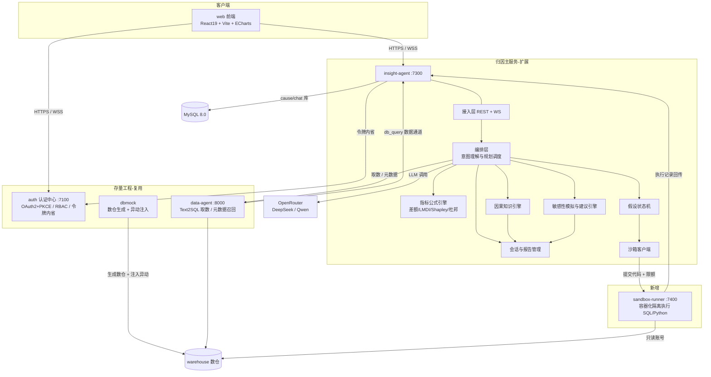
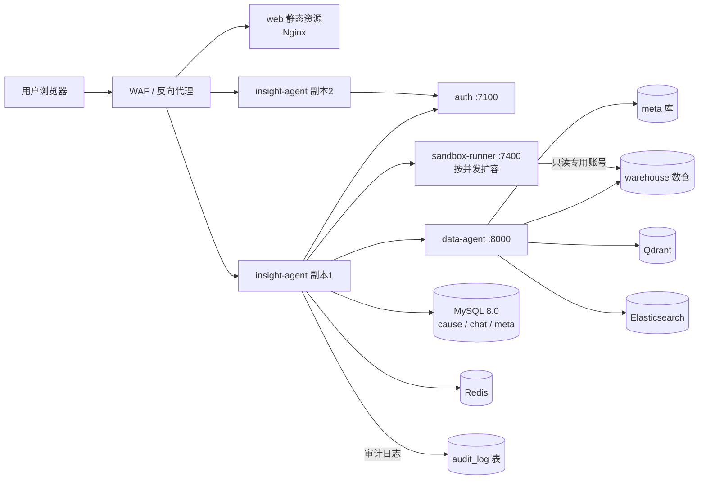
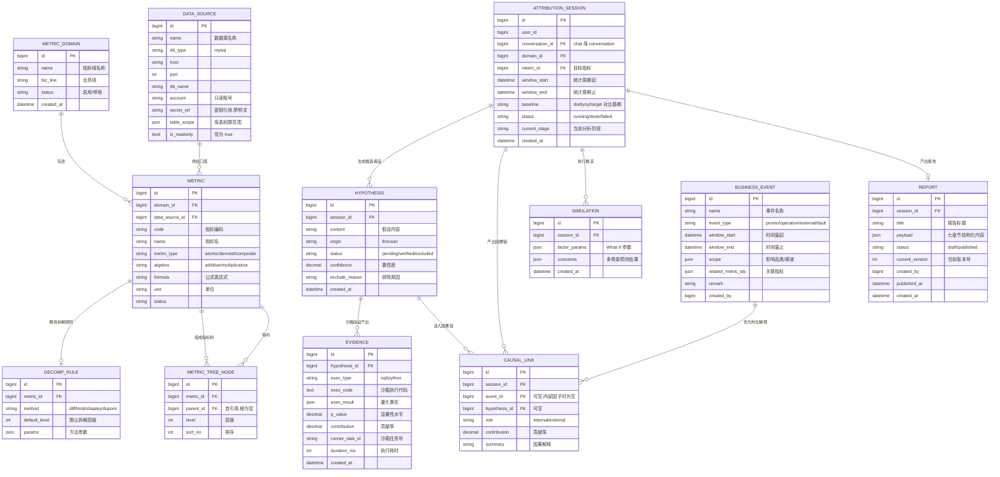
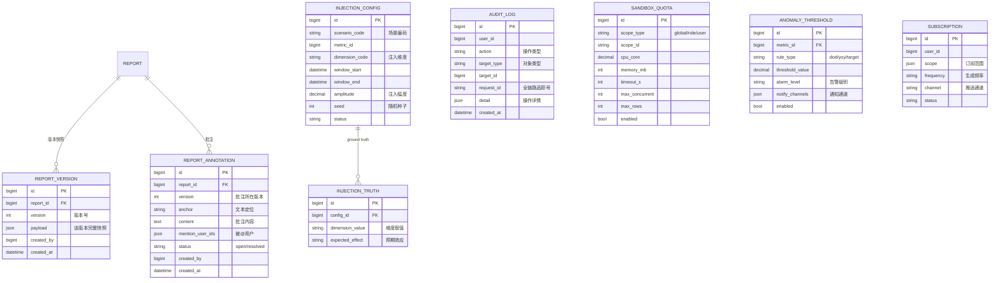
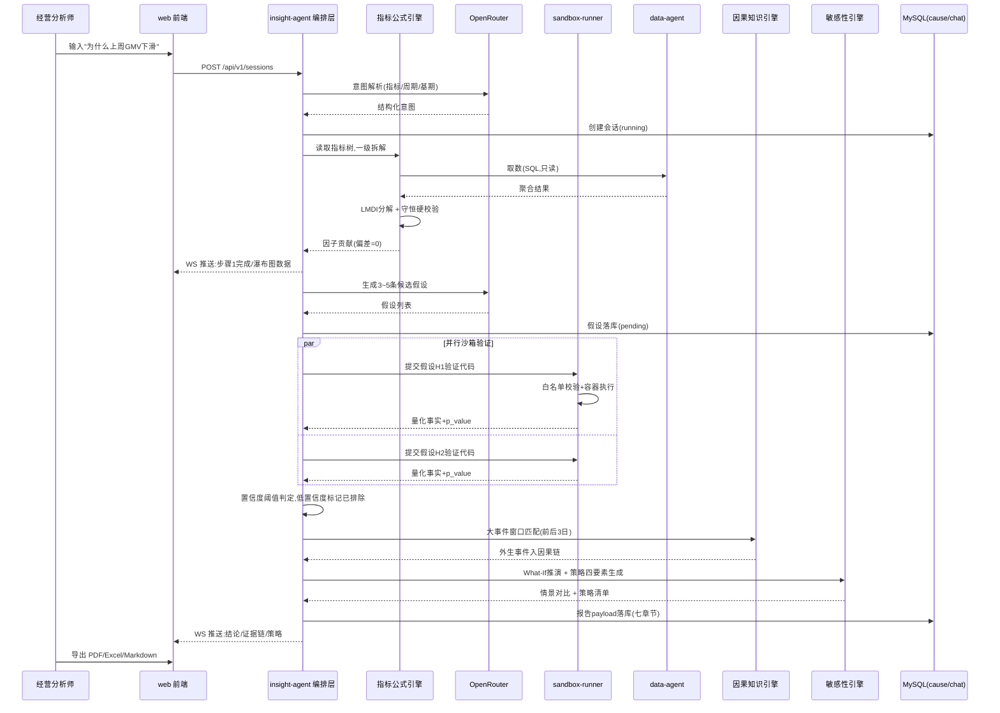
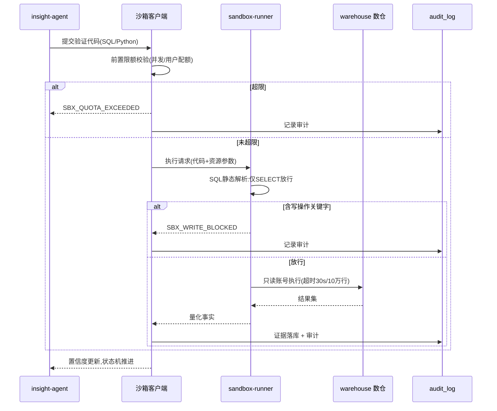

# cause_trace 经营归因分析系统 技术设计规格说明书（Design Spec）

> | 文档名称 | cause_trace 经营归因分析系统 技术设计规格说明书 |
> |----------|-------------------|
> | 版本 | v0.1 |
> | 架构师角色 | 系统架构师 |
> | 日期 | 2026-10-14 |
> | 状态 | 评审稿 |
> | 依据 PRD | 《cause_trace 经营归因分析系统 PRD》v1.2（确认基线） + 《需求参考》2.1 节 |
>
> 本文档承接 PRD v1.2，将「要什么」翻译为「怎么做」：架构风格、技术栈、模块划分、部署拓扑、数据模型、接口契约、时序流程、非功能落地手段、关键选型 ADR 与任务分解。PRD 中的 FR-01~FR-24、验收标准（AC）、待确认问题（Q1~Q12）在本文档中均可回溯。

---

## 变更记录

| 版本 | 日期 | 作者 | 变更说明 |
|------|------|------|----------|
| v0.1 | 2026-10-14 | 系统架构师 | 初稿，基于 PRD v1.2 产出全部章节 |

---

## 1. 架构设计概述

### 1.1 架构风格

**前后端分离 + 存量四工程复用 + 归因主服务扩展 + 安全沙箱独立执行器**。

整体由五部分构成：

- **auth（7100，复用）**：统一认证中心（OAuth2 + PKCE、RBAC、令牌内省），附 platform 门户入口。
- **insight-agent（7300，扩展为归因主服务）**：归因业务的唯一编排入口，内部划分为接入层（REST + WebSocket）、Agent 编排层（意图理解与规划调度）、归因业务层（指标公式引擎 / 假设状态机 / 因果知识引擎 / 敏感性模拟与建议引擎）、会话与报告管理层、沙箱客户端。
- **sandbox-runner（新增，内部端口建议 7400）**：独立部署的容器化沙箱执行器，SQL/Python 验证代码的唯一执行场所。
- **data-agent（8000，复用 + 安全整改）**：Text2SQL 取数通道与元数据召回（BGE 向量 + ES）。
- **web 前端（扩展 insight-agent/web）**：React 19 + Vite 7 三栏交互式归因工作台。
- **dbmock（复用 + 增强）**：示例数仓生成器，新增异动仿真注入与 ground truth 标记。

### 1.2 选型理由与权衡

| 决策点 | 选择 | 理由 | 放弃了什么 |
|--------|------|------|-----------|
| 服务边界 | 复用 auth / data-agent / dbmock / insight-agent 四工程，归因能力主要落在 insight-agent 内扩展 | PRD 硬约束（不推倒重来）；认证、多轮会话三表、WS 流式、Text2SQL 链路、电商数仓已占目标工作量 35%~40%（PRD 附录 A 结论） | 全新独立「归因服务」——重复建设会话与取数能力 |
| 归因主服务载体 | insight-agent 而非新建服务 | 归因与会话状态强耦合（上下文继承、断点保持、多轮追问），其三表（conversation/message/context_compaction）与 deepagents 工具调用已就绪 | 新建归因服务后反向打通会话状态 |
| 沙箱执行器 | 独立 sandbox-runner 服务（容器化） | 安全硬约束（禁碰宿主机与生产数仓写权限）要求进程/容器级隔离；资源限额、超时、白名单需可强制执行的边界；沙箱故障不阻塞分析会话其他能力（PRD 非功能） | 在 insight-agent 进程内执行用户代码 |
| 公式引擎部署 | insight-agent 内纯函数模块，不独立部署 | 计算为轻量数值运算（百万级以内聚合主要由 SQL 侧完成），20 并发量级下单机可扛；纯函数形态便于守恒性单测，未来可无损拆出 | 公式引擎独立微服务——当前收益低于运维成本 |
| LLM 编排方式 | 服务端编排（规划器 + 假设状态机），LLM 只做生成与解释 | PRD 附录 A 差距分析：分析链路不能依赖提示词自由发挥，需固化为「规划→执行→校验」 | 纯 Prompt 驱动的一次性生成 |
| 前端形态 | 扩展 insight-agent/web 为准三栏工作台 | 会话列表 + 消息流 + 条件性 HTML 预览雏形已在；补图表库、透视表、What-If 三个交互模块 | 前端重写 |

### 1.3 架构目标回溯（对应 PRD 1.3 成功标准）

| PRD 成功标准 | 架构落点 |
|--------------|----------|
| 守恒性（贡献量之和与总变动偏差为 0） | 指标公式引擎输出后执行守恒硬校验（ADR-03），校验不过不出图、不进报告 |
| 假设闭环（3~5 条并行假设、低置信度自动排除） | 假设状态机 + 沙箱并行验证（FR-10/11） |
| 事件关联（前后 3 日窗口 100% 匹配） | 因果知识引擎窗口匹配规则（FR-12） |
| 策略可执行（绑定因子/角色/周期/金额） | 敏感性引擎策略模板四要素强校验（FR-17） |
| 交付完整性（2 场景闭环 + 三格式导出） | dbmock 异动注入 + 报告渲染导出层（FR-16/20/23） |

---

## 2. 技术栈与依赖

| 层 | 技术选型 | 用途 | 来源 |
|----|---------|------|------|
| 前端 | React 19 + Vite 7 + TypeScript + Tailwind + zustand | 三栏归因工作台 | 既有（PRD 约束） |
| 前端图表 | ECharts 5 | 瀑布图 / 杜邦拆解树 / 桑基图 / 时序趋势 | **本次引入**（现状前端无图表依赖） |
| 前端表格 | TanStack Table v8 | 动态透视表（层级折叠 / 列头排序 / 差额高亮） | **本次引入** |
| 后端 | Python 3.12 + uv + FastAPI + SQLAlchemy | 归因主服务与沙箱服务 | 既有（PRD 约束） |
| Agent 运行时 | deepagents（insight-agent 已有） | 工具调用、子 Agent、WS 流式 | 既有 |
| 数值计算 | numpy / pandas | LMDI / Shapley / 差额分析 / 弹性系数 | **本次引入** |
| 沙箱隔离 | Docker 容器（或 nsjail，待 Q3 拍板） | SQL/Python 隔离执行 | **本次引入** |
| 存储 | MySQL 8.0：`cause`（新库）/ `chat` / `meta` / `warehouse` | 归因业务 / 会话 / 元数据 / 数仓 | 既有 + 新库 |
| 缓存 | Redis | WS 一次性令牌、会话断点缓存、大盘预计算 | 既有 |
| 检索 | Elasticsearch + Qdrant + TEI(BGE) | 字段取值检索 / 向量召回 / 向量化（data-agent） | 既有 |
| LLM | OpenRouter 网关（DeepSeek / Qwen） | 意图解析、假设生成、代码生成、报告撰写 | 既有（外部服务） |
| 外部检索 | Tavily MCP | 外部信息检索（可选增强） | 既有（外部服务） |
| 导出渲染 | LibreOffice（服务端）或 SheetJS + 浏览器打印（前端） | PDF / Excel 导出 | **待 Q4 选型** |

**第三方依赖说明**：区分「团队既定」（上表标既有，均为 PRD 第 11 章既有资产）与「本次引入」（ECharts、TanStack Table、numpy/pandas、沙箱容器运行时）。LibreOffice / 报表渲染组件为待选型依赖（PRD Q4）。

---

## 3. 模块 / 服务划分

### 3.1 服务拓扑



### 3.2 模块职责边界

| 模块 / 服务 | 做什么 | 不做什么 | 对应 FR |
|------------|--------|----------|---------|
| auth（7100） | 登录、令牌签发与内省、RBAC 权限实时刷新、platform 门户入口 | 不做任何归因业务逻辑 | FR-01 |
| web 前端 | 三栏工作台、流式渲染、可视化、透视表、What-If 交互、报告组装导出 | 不做归因计算与统计检验（全部服务端） | FR-08/13/14/15/16/22 |
| insight-agent 接入层 | REST/WS 网关、introspection scope 鉴权、请求限流 | 不做业务编排 | FR-01/07/18 |
| 编排层（意图理解与规划调度） | 解析目标指标/时间范围/基期；生成分析计划；驱动假设生成；汇总各引擎结果 | 不做统计计算（交公式引擎/沙箱）、不做存储细节 | FR-09/10 |
| 指标公式引擎 | 指标树解析；差额分析 / LMDI / Shapley / 杜邦分解；**守恒硬校验** | 不取数（SQL 由 data-agent / 沙箱执行）、不调 LLM | FR-04/14 |
| 假设状态机 | 假设生命周期（pending→verified/excluded）；置信度阈值自动排除 | 不生成假设内容（LLM 生成）、不执行代码 | FR-10/11 |
| 因果知识引擎 | 事件日历前后 3 日窗口匹配；时间/品类/渠道重合度计算；因果链组装 | 不做假设统计验证 | FR-12 |
| 敏感性模拟与建议引擎 | 弹性系数拟合；What-If 多情景重算；策略四要素（因子/角色/周期/金额）生成与校验 | 不做前端交互细节 | FR-13/17 |
| 会话与报告管理 | 多轮上下文维护（复用 chat 三表）；中间快照；七章节 payload 结构化落库；版本与批注 | 不做报告渲染格式细节（交导出层） | FR-07/16/22 |
| 沙箱客户端 | 执行前置限额校验；代码提交 sandbox-runner；结果回写证据表 | 不本地执行任何用户代码 | FR-11/21 |
| sandbox-runner（7400） | 容器内隔离执行 SQL/Python；SQL 白名单（仅 SELECT）；写操作拦截；CPU/内存/超时/行数配额 | 不解析业务语义、不直连前端（仅 insight-agent 可调） | FR-11/21 |
| data-agent（8000） | Text2SQL 取数、元数据与指标召回（Qdrant/ES） | 不承担归因编排；SQL 执行侧加固为只读/超时/行数限制 | FR-05/06 |
| dbmock | 24 张 DWD 表生成、SCD2、大促加权；**新增**异动仿真注入与 ground truth | 不参与在线归因请求 | FR-20/23 |

---

## 4. 部署拓扑

### 4.1 生产拓扑



### 4.2 环境差异

| 环境 | 部署形态 | 差异说明 |
|------|---------|---------|
| dev | 单机 Docker Compose | 四工程 + sandbox-runner + MySQL/Redis/Qdrant/ES 全量本地起；LLM 走测试 Key |
| test | 单机 Compose | 导入 dbmock 全量示例数据（含注入异动）；用于 AC 验收与场景演示 |
| staging | 单机 / 双副本 | 数据脱敏副本；沙箱配额按生产同款收紧；导出链路联调 |
| prod | 多副本 + WAF | insight-agent 无状态多副本（会话断点存 Redis/MySQL）；sandbox-runner 按配额水位扩容；审计保留期管理；敏感配置经环境变量注入（ADR-06） |

**说明**：当前并发目标为 ≥20 归因会话（建议值，Q1 待拍板），单机双副本可承载；不强制引入 K8s，Compose 编排起步，保留横向扩展能力（insight-agent 无状态、sandbox-runner 可多副本）。

---

## 5. 数据模型（ER）

### 5.1 核心归因域（新建 `cause` 库）



### 5.2 治理与资产域（`cause` 库 + dbmock 侧）



### 5.3 建表规约与现有表关系

- **库划分**：归因业务表全部落在新建 `cause` 库；`chat` 库（conversation / message / context_compaction）继续承载多轮对话，`ATTRIBUTION_SESSION.conversation_id` 与 conversation 一对一关联（会话即对话）；`meta` 库（table_info / column_info / metric_info / column_metric）作为 DATA_SOURCE 与 METRIC 的元数据基础来源；`warehouse` 为只读数仓。
- **关键索引**：`attribution_session(user_id, status, created_at)`；`hypothesis(session_id, status)`；`evidence(hypothesis_id)`；`causal_link(session_id)`；`business_event(window_start, window_end)`；`audit_log(request_id)`、`audit_log(user_id, created_at)`；`report(session_id)`。
- **约束**：`data_source.secret_ref` 禁明文（ADR-06）；`report.payload` 入库前过七章节 JSON Schema 校验；`evidence.exec_code` 全量留痕满足审计回溯。
- **与 dbmock 的关系**：INJECTION_CONFIG / INJECTION_TRUTH 由 dbmock 写入，演示验收时归因服务只读比对，ground truth 是否对前端隐藏见 PRD Q9。

---

## 6. 关键接口定义

### 6.1 核心 API 清单

| 编号 | 方法 | 路径 | 说明 | 对应 FR |
|------|------|------|------|---------|
| API-01 | POST | /api/v1/sessions | 创建归因会话（自然语言意图或大盘一键发起），返回 session_id 与解析后的意图结构 | FR-07/08/09 |
| API-02 | GET | /api/v1/sessions/{id} | 会话详情：阶段状态、假设看板、证据链摘要、结论卡片 | FR-07/09 |
| API-03 | POST | /api/v1/sessions/{id}/followup | 多轮追问：继承上下文、锁定异常切片继续下钻 | FR-07/09 |
| API-04 | POST | /api/v1/sessions/{id}/hypotheses/{hid}/verify | 触发假设沙箱验证（生成并提交探查代码） | FR-10/11 |
| API-05 | GET | /api/v1/metrics/{id}/decomposition | 指标树一级拆解：按规则返回差额/LMDI/Shapley/杜邦结果与守恒校验标记 | FR-04/14 |
| API-06 | POST | /api/v1/sessions/{id}/simulate | What-If 推演：提交因子参数，返回多情景预测与对比区间 | FR-13 |
| API-07 | POST | /api/v1/sessions/{id}/report | 组装七章节结构化报告并落库 | FR-16 |
| API-08 | GET | /api/v1/events | 事件日历检索（支持 window_start/window_end/scope 过滤，用于前后 3 日匹配） | FR-12 |
| API-09 | PUT | /api/v1/admin/sandbox-quota | 沙箱安全配额配置（管理员，超限拒绝并记审计） | FR-21 |
| WS-01 | WS | /ws/v1/sessions/{id} | 流式推送：意图解析结果、规划步骤、假设卡片流、工具调用状态（单步可见延迟 ≤2s） | FR-09/14 |

### 6.2 OpenAPI 片段（API-01 创建归因会话）

```yaml
post:
  summary: 创建归因会话
  requestBody:
    content:
      application/json:
        schema:
          type: object
          required: [domain_id, metric_id, baseline]
          properties:
            domain_id: { type: integer }
            metric_id: { type: integer }
            baseline: { type: string, enum: [dod, yoy, target] }
            window:
              type: object
              properties:
                start: { type: string, format: date-time }
                end: { type: string, format: date-time }
            query: { type: string, description: "自然语言归因需求,可空" }
            from_dashboard: { type: boolean, description: "大盘一键发起标记" }
  responses:
    '201':
      description: 创建成功
      content:
        application/json:
          schema:
            type: object
            properties:
              session_id: { type: integer }
              intent:
                type: object
                properties:
                  metric: { type: string }
                  time_range: { type: string }
                  baseline: { type: string }
              ws_url: { type: string }
    '400': { description: 参数错误, 错误码: BIZ_INVALID_INTENT }
    '401': { description: 未认证, 错误码: AUTH_UNAUTHORIZED }
    '403': { description: 无业务线数据权限, 错误码: AUTH_FORBIDDEN_SCOPE }
    '429': { description: 超出并发会话配额, 错误码: BIZ_SESSION_LIMIT }
```

### 6.3 错误码体系

| 段位 | 含义 | 示例 |
|------|------|------|
| AUTH_ | 认证鉴权 | AUTH_UNAUTHORIZED（令牌无效/过期）、AUTH_FORBIDDEN_SCOPE（业务线数据越权） |
| BIZ_ | 归因业务 | BIZ_INVALID_INTENT（意图无法解析）、BIZ_CONSERVATION_FAILED（守恒校验失败）、BIZ_SESSION_LIMIT（并发超限）、BIZ_METRIC_NOT_FOUND |
| SBX_ | 沙箱执行 | SBX_WRITE_BLOCKED（写操作被拦截）、SBX_TIMEOUT（执行超时）、SBX_QUOTA_EXCEEDED（资源配额超限）、SBX_ROW_LIMIT（结果集超限） |
| SYS_ | 系统故障 | SYS_INTERNAL、SYS_LLM_UNAVAILABLE（模型服务不可用，可降级重试） |

---

## 7. 关键流程时序图

### 7.1 归因主流程（发起 → 拆解 → 假设 → 验证 → 因果 → 仿真 → 报告）



### 7.2 沙箱验证安全流程（API-04）



---

## 8. 非功能设计

| 维度 | PRD 指标 | 设计手段 |
|------|---------|---------|
| 安全 | 沙箱隔离（只读账号 + SQL 白名单 + 写操作拦截 + 资源限额；Python 与宿主机隔离） | sandbox-runner 容器化独立部署；SQL 静态解析白名单（仅 SELECT，INSERT/UPDATE/DELETE/DDL 关键字拦截）；warehouse 专用只读账号（整改 root 直连，FR-06）；Python 执行在容器内，无宿主机挂载；配额超限拒绝并记审计（API-09 / FR-21） |
| 安全 | 认证与令牌（OAuth2 + PKCE(S256)、服务端内省、WS 一次性令牌 30s） | 复用 auth；insight-agent 所有接口经 introspection 校验 scope；业务接口按 `read:insight-agent` 等权限点细粒度鉴权 |
| 安全 | LLM Key 等敏感配置禁明文 | ADR-06：密钥经环境变量/密钥管理注入，`data_source.secret_ref` 只存引用；存量 data-agent/insight-agent 明文 Key 列入整改任务（T-25） |
| 安全 | 数据脱敏（手机/邮箱/姓名/地址） | 沿用 dbmock 脱敏规范生成示例数据；沙箱结果集对外展示前过脱敏过滤器 |
| 安全 | 审计留痕 | `audit_log` 表全量记录分析操作、模型调用、沙箱执行；`request_id` 贯穿前后端；审计查询/导出/保留期管理（FR-18） |
| 性能 | 分析步骤流式反馈，单步可见延迟 ≤2s（建议值） | WS 长连接推送阶段状态；各引擎完成即推事件，不等全链路结束；断点与中间快照落 Redis/MySQL，刷新不丢进度 |
| 性能 | 沙箱 SQL 单条 ≤30s、结果集 ≤10 万行、单用户并发 ≤3 | sandbox-runner 服务端强制超时与行数截断；沙箱客户端前置并发校验 |
| 性能 | 大盘首屏 ≤3s（P95，建议值） | 指标概览预计算 + Redis 缓存（TTL 5 分钟）；异动列表走 `anomaly_threshold` 配置化计算，避免实时全表扫描 |
| 性能 | 千万级事实表聚合 | data-agent 侧 SQL 执行加固（只读/超时/行数）；warehouse 按时间 + 维度建索引；下钻查询带 LIMIT 与分区裁剪 |
| 高可用 | 核心服务 SLA ≥99.5%（建议值）；沙箱失败不阻塞会话 | insight-agent 无状态多副本；沙箱失败时假设标记「验证失败」而非中断会话；LLM 调用熔断 + 指数退避重试，连续失败降级为「待人工确认」假设 |
| 可观测 | 全链路追踪 request_id（已实现）+ 步骤级审计可回溯 | 结构化日志（loguru）带 request_id / session_id / hypothesis_id；假设-验证-结论三级证据链可回溯（EVIDENCE 全量留痕）；监控指标：会话数、沙箱任务排队/成功率、LLM 调用延迟与失败率（Prometheus 端点为推荐增强） |

---

## 9. 设计决策记录（ADR）

| 编号 | 决策 | 背景 / 选项 | 选择理由 | 后果 |
|------|------|-------------|---------|------|
| ADR-01 | 复用 insight-agent 为归因主服务，归因引擎以模块形式内嵌扩展 | 选项 A：新建独立归因服务；选项 B：insight-agent 内扩展 | 会话三表、WS 流式、deepagents 工具调用、db_query→data-agent 通道已就绪；归因与会话状态强耦合 | 主服务代码体量上升，需以模块边界（公式/假设/因果/敏感性四引擎）控制耦合；未来高负载时可拆出公式引擎（纯函数，拆出成本低） |
| ADR-02 | 沙箱执行器独立为 sandbox-runner 容器化服务 | 选项 A：insight-agent 进程内执行；选项 B：独立容器服务；选项 C：微 VM | 安全硬约束要求隔离边界；限额/超时/白名单需强制生效；故障隔离（沙箱挂不影响会话） | 新增一个部署单元与内部接口；Python 隔离粒度（容器/微VM/nsjail）待 PRD Q3 拍板 |
| ADR-03 | 守恒性以「算法保证 + 硬校验」双保险实现 | 选项 A：仅依赖 LMDI 无残差数学性质；选项 B：输出后强制数值校验 | PRD 成功标准要求偏差为 0 且为硬验收；加法差额/Shapley 亦须校验 | 公式引擎输出必经校验，`BIZ_CONSERVATION_FAILED` 时禁止出图与入报告；带来可忽略的计算开销 |
| ADR-04 | 分析流程服务端编排（规划器 + 假设状态机），LLM 只做生成与解释 | 选项 A：纯 Prompt 一次性生成全部分析；选项 B：服务端编排 + LLM 生成 | PRD 附录 A 差距分析明确「不能依赖提示词自由发挥」；状态机使假设生命周期、伪相关排除、断点恢复可测试 | 编排逻辑复杂度上升；换模型/换提示词不影响流程结构 |
| ADR-05 | 报告以七章节 JSON Schema 结构化落库，导出层按格式渲染 | 选项 A：直接渲染 HTML 后转档；选项 B：payload 落库 + 渲染层导出 | FR-16/FR-22 要求结构化、版本对比、批注、三格式导出一源多用 | payload schema 需评审固化；导出渲染依赖选型待 PRD Q4 |
| ADR-06 | 敏感配置（LLM Key、数仓密码）统一密钥引用，禁明文入库/入配置库 | 选项 A：维持配置文件明文（现状）；选项 B：环境变量 + 密钥引用 | PRD 安全约束明确要求整改；`data_source.secret_ref` 设计为引用而非密文 | 部署需配套密钥注入机制；存量四工程明文 Key 列入整改任务 |

---

## 10. 任务分解清单

> 排序即建议实现顺序；「可并行」任务在依赖满足后即可开工，用于排期并行度参考。

| 任务编号 | 模块 | 依赖 | 说明 | 对应 FR |
|---------|------|------|------|---------|
| T-01 | 数据层 | 无 | `cause` 库建表 + SQLAlchemy 模型 + 七章节 payload JSON Schema | FR-03/04/07/16/18/21/22/23 |
| T-02 | data-agent 安全整改 | 无 | warehouse 只读专用账号；SQL 执行加超时/行数限制 | FR-06/11 |
| T-03 | sandbox-runner | 无（联调依赖 T-02） | 容器化执行骨架：SQL 静态解析白名单、写操作拦截、CPU/内存/超时/行数配额、内部鉴权（仅 insight-agent 可调） | FR-11/21 |
| T-04 | 指标公式引擎 | T-01 | 差额分析 / LMDI / Shapley / 杜邦分解纯函数实现 + 守恒硬校验 + 单测（偏差必须为 0） | FR-04/14 |
| T-05 | 指标字典与指标树 | T-01、T-04 | 指标/拆解规则/树节点 CRUD API；默认拆解层级树；元数据从 `meta_config.yaml` 迁入可管理存储 | FR-03 |
| T-06 | 编排层 | T-01 | 意图理解（指标/周期/基期解析）+ 规划调度（识别异动→拆解→下钻→假设→检验→归因→建议） | FR-09 |
| T-07 | 假设状态机 | T-06 | 假设实体生命周期 pending→verified/excluded；置信度阈值自动排除；假设看板数据结构 | FR-10 |
| T-08 | 沙箱验证闭环 | T-03、T-07 | 沙箱客户端（前置限额校验、代码提交、证据回写）；假设验证 API-04；并行验证调度 | FR-11 |
| T-09 | 因果知识引擎 | T-01 | 事件日历 CRUD；前后 3 日窗口匹配；时间/品类/渠道重合度计算；因果链组装 API-08 | FR-12 |
| T-10 | 敏感性模拟与建议引擎 | T-04、T-09 | 弹性系数拟合（基于归因结果与历史波动）；What-If 多情景重算 API-06；策略四要素生成与强校验 | FR-13/17 |
| T-11 | 会话与报告管理 | T-01 | 复用 chat 三表；中间快照；报告组装 API-07（七章节落库）；版本快照与批注 | FR-07/16/22 |
| T-12 | 前端基架 | API 契约（T-05~T-11 先行定义） | 引入 ECharts + TanStack Table；三栏工作台改造（持久化动态看板替换条件性 iframe 预览） | FR-14/15 |
| T-13 | 指标异动大盘页 | T-05、T-12 | 监控看板、异常标识（日环比跌幅超阈值）、一键发起归因 | FR-08/24 |
| T-14 | 数据可视化引擎 | T-04、T-12 | 因子贡献瀑布图、杜邦拆解树、下钻时序趋势图、桑基图、假设卡片流 | FR-14 |
| T-15 | 动态透视表 | T-12 | 多维层级折叠、列头排序、差额高亮染色、一键导出当前表格 | FR-05/15 |
| T-16 | What-If 仿真器 | T-10、T-12 | 驱动因子滑块调参、敏感度曲线实时重算、情景对比 | FR-13 |
| T-17 | 报告组装与导出页 | T-11、T-12 | 七章节预览、批注协同（@提及通知、只读控制）、版本对比、三格式导出（方案待 Q4） | FR-16/22 |
| T-18 | 配置类页面 | T-05、T-09、T-12 | 业务事件日历页、指标字典配置页（树拖拽调整） | FR-03/12 |
| T-19 | 异动仿真注入 | T-01 | dbmock 按「时间窗 × 维度 × 指标 × 幅度」注入异动；INJECTION_CONFIG/TRUTH 落库；ground truth 对照（隐藏策略待 Q9） | FR-23 |
| T-20 | 电商场景闭环 | T-08、T-09、T-10、T-11、T-19 | 「电商 GMV 下滑」全链路演示（含 08-12 转化率注入异动定位） | FR-20 |
| T-21 | 快消/SaaS 场景 | T-19、T-20 | 快消品利润率、SaaS 续约率场景数据构建（至少再完成 1 个场景闭环） | FR-20 |
| T-22 | 多格式导出 | T-11 | Markdown / Excel / PDF 三格式导出实现（选型待 Q4） | FR-16 |
| T-23 | 审计治理 | T-01、T-08 | `audit_log` 落库与查询导出；保留期管理；request_id 全链路对齐 | FR-18 |
| T-24 | 配额与阈值配置 | T-01、T-03 | 沙箱配额 API-09；异常检测阈值配置（按指标的日环比/同比/目标差规则与告警通道） | FR-21/24 |
| T-25 | 认证与密钥整改 | 无 | LLM Key 明文整改（ADR-06）；auth 生产数据库适配评估（现仅 SQLite）；登录限流/防爆破 | FR-01/18 |

**并行建议**：T-12~T-18（前端）与 T-06~T-11（后端）按 API 契约并行推进；T-19（数据注入）可与后端并行；T-20/T-21（场景闭环）必须依赖对应引擎就绪后串行执行。

---

## 11. 待明确事项

| 编号 | 问题 | 建议确认方 |
|------|------|-----------|
| Q-A（源自 PRD Q3） | Python 沙箱隔离级别选型（容器 / 微 VM / nsjail）及安全责任边界、沙箱资源配额上限 | 技术负责人 + 安全 |
| Q-B（源自 PRD Q4） | 报告 PDF/Excel 导出采用服务端渲染（LibreOffice）还是前端导出（SheetJS/打印）；批注存储方式 | 产品 + 技术负责人 |
| Q-C（新增） | LLM Key 与数仓密码的托管方式（环境变量注入 / 配置中心 / KMS），决定 ADR-06 落地形态 | 技术负责人 + 运维 |
| Q-D（新增） | `cause` 独立新库 vs 归因业务表并入 `chat` 库（影响备份策略与权限边界）；PRD 附录 A/B 中 platform 门户端口（7100/7300）表述不一致，需以现状代码核对 | 技术负责人 |
| Q-E（源自 PRD Q12） | 异常告警通道归属 FR-12 事件日历还是 FR-24 阈值配置，两模块边界如何界定 | 产品 + 业务负责人 |
| Q-F（源自 PRD Q7） | 报告协同范围：仅批注评论还是多人实时协同编辑；版本保留策略 | 产品 + 业务负责人 |
| Q-G（源自 PRD Q10） | 沙箱 Python 执行是否允许安装第三方包；包白名单与镜像源管理 | 技术负责人 + 安全 |
| Q-H（源自 PRD Q1） | 非功能建议值拍板（首屏 ≤3s、SLA 99.5%、并发 20 会话、单步延迟 ≤2s） | 业务负责人 + 技术负责人 |

---

## 附录 A：FR-设计映射矩阵（P0 全覆盖核对）

| FR | 模块 | 数据表 | 接口 / 通道 |
|----|------|--------|------------|
| FR-01 统一认证登录 | auth（复用） | auth 库 | introspection + scope 鉴权 |
| FR-02 多指标域与业务线 | 编排层 | metric_domain | 域/业务线管理 API |
| FR-03 指标字典配置 | 指标公式引擎 + T-05 | metric、decomp_rule、metric_tree_node | 字典配置 API + 配置页（T-18） |
| FR-04 指标树与贡献率分解 | 指标公式引擎 | decomp_rule | API-05 + 守恒校验（ADR-03） |
| FR-05 多维交叉下钻 | data-agent + 前端透视表 | metric_tree_node | Text2SQL + 透视表（T-15） |
| FR-06 数据源接入 | data-agent 整改 | data_source | 只读账号 + 执行加固（T-02） |
| FR-07 归因会话管理 | 会话与报告管理 | attribution_session、chat 三表 | API-01/02/03 + WS-01 |
| FR-08 指标异动大盘 | 前端 | anomaly_threshold、Redis 缓存 | 大盘页（T-13） |
| FR-09 意图理解与多轮追问 | 编排层 | attribution_session.current_stage | API-03 + WS-01 |
| FR-10 假设自动生成 | 编排层 + 假设状态机 | hypothesis | LLM 生成 + 假设看板（T-07） |
| FR-11 假设沙箱验证 | sandbox-runner + 沙箱客户端 | evidence | API-04 + 时序 7.2 |
| FR-12 大事件因果关联 | 因果知识引擎 | business_event、causal_link | API-08 + 前后 3 日匹配（T-09） |
| FR-13 What-If 仿真 | 敏感性引擎 + 前端 | simulation | API-06 + 仿真器（T-16） |
| FR-14 数据可视化引擎 | 前端 | —（数据来自各引擎） | ECharts 图表组件（T-14） |
| FR-15 动态透视表 | 前端 | — | TanStack Table（T-15） |
| FR-16 报告组装与导出 | 会话与报告管理 + 导出层 | report、report_version | API-07 + 三格式导出（T-22，待 Q4） |
| FR-17 落地策略生成 | 敏感性引擎 | causal_link、simulation | 策略四要素强校验（T-10） |
| FR-18 操作审计与运行日志 | 接入层 + 沙箱客户端 | audit_log | 审计查询/导出（T-23） |
| FR-19 周期简报订阅（P2） | 会话与报告管理 | subscription | 定时任务（P2 后排期） |
| FR-20 示例数据集与仿真案例 | dbmock + T-20/T-21 | warehouse | 两场景闭环 |
| FR-21 沙箱配额管理 | sandbox-runner + 沙箱客户端 | sandbox_quota | API-09 + 超限拒绝审计（T-24） |
| FR-22 报告在线协同 | 会话与报告管理 | report_annotation、report_version | 批注 + @通知 + 只读控制（T-17） |
| FR-23 异动仿真注入 | dbmock + T-19 | injection_config、injection_truth | ground truth 对照 |
| FR-24 异常检测阈值配置（P1） | 前端 + 大盘 | anomaly_threshold | 阈值配置（T-13/T-24） |

> 依据本矩阵，PRD v1.2 全部 P0 功能均有模块、数据表与接口落点，无遗漏、无职责重叠（模块边界见 3.2 节）。
